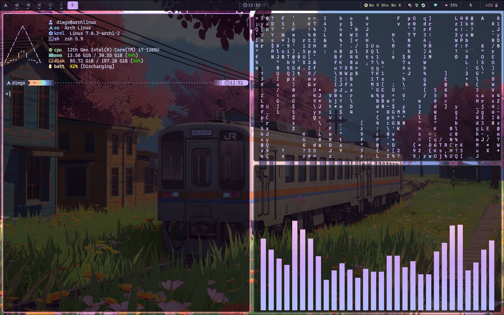
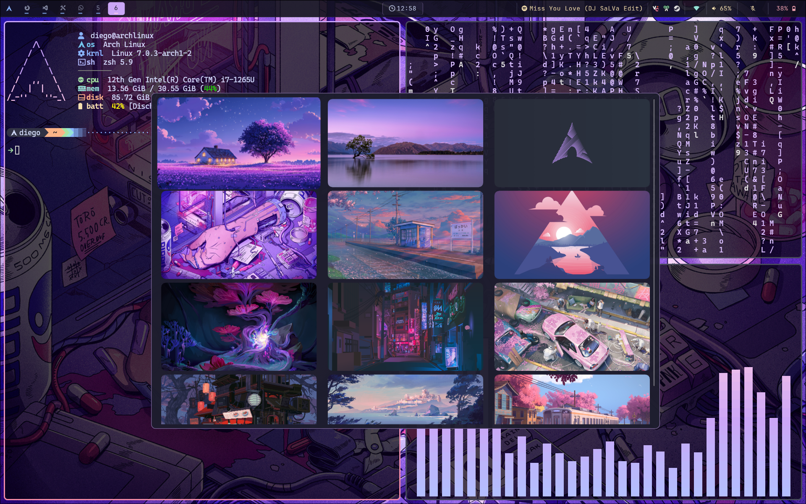

# DLH dotfiles

Configuracion personal para Hyprland, Waybar, Kitty, Zsh y herramientas de terminal.

## Screenshots

<p align="center">
    
</p>

<p align="center">
     
</p>

## Estructura

- `home/`: archivos que se enlazan directamente en `$HOME` con GNU Stow.
- `home/.config/`: configuraciones de aplicaciones.
- `home/scripts/`: scripts personales usados por el entorno.
- `install.sh`: instalador simple basado en Stow.

## Instalacion

```bash
git clone git@github.com:elDiego1415/DLH_dotfiles.git ~/dotfiles
cd ~/dotfiles
./install.sh
```

El instalador ejecuta:

```bash
./install.sh --check  # simula los enlaces y detecta conflictos sin modificar archivos
./install.sh         # crea los enlaces
```

También admite `./install.sh --adopt` para adoptar archivos existentes. Esta opción puede modificar el repositorio y muestra un aviso antes de continuar; revisa antes los conflictos con `--check`. `--check` y `--adopt` no se pueden combinar. El instalador solo enlaza la configuración; no instala paquetes. Consulta `RESTORE.md` para el proceso completo.

## Incluye

- Shell: `.zshrc`, `.bashrc`, `.bash_profile`, `.gitconfig`
- Entorno grafico: `hypr`, `waybar`, `eww`, `mako`, `wofi`, `gtk-3.0`, `xsettingsd`
- Terminal y CLI: `kitty`, `nvim`, `btop`, `fastfetch`, `yazi`, `lsd`, `lazygit`, `cava`
- Otros: `quickshell`, `waypaper`, `mpv`, scripts personales

Eww se instala desde AUR con la lista de `packages/aur.txt`. Al iniciar Hyprland,
el listener de Eww arranca el daemon y muestra los widgets de perfil, disco y
S&P 500 cuando el escritorio activo queda vacío. La foto de perfil es opcional:
se detectan `~/.face` y `~/.face.icon`, con un avatar genérico como alternativa.

## Restauracion

Consulta `RESTORE.md` para reinstalar paquetes y volver a enlazar la configuracion.
